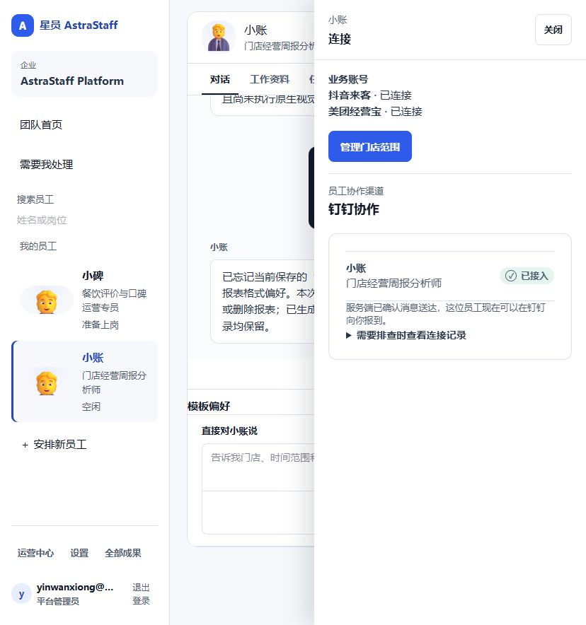

## A 总盘：现在大体到哪了 {span=2}
```callout info 产品落地管理进度 ≈ 62%
按“关键产品节点 × 业务权重”折算，不是工时、代码量或测试数量。平台骨架基本成型；现在正在把独立能力串成第一个真实客户结果。
```

```kv cols=4
总体进度: ██████░░░░ 62%
首单月报: ██████░░░░ 64%
平台底座: ████████░░ 85%
客户验收: 🔴 0 / 2
当前主节点: 🟡 一句话稳定进入员工执行
生产状态: 🟢 健康
Control: 🟢 没偏
需要你: ✅ 暂无
```

```flow LR
产品骨架: ✅ -> 核心能力: ✅
核心能力 -> *首单串联: 🟡 当前
*首单串联 -> 真实交付: ⚪
真实交付 -> 客户验收: ⚪ 0/2
```

**怎么看这页：** 绿色＝已经证明；蓝色＝单项能力已就绪、还没在最新 E2E 串起来；黄色＝当前正在攻的节点；灰色＝还没轮到。

## B 业务线进度雷达 {span=2}
| 业务线 | 大体进度 | 当前节点 | 下一节点 |
| --- | --- | --- | --- |
| **首单经营月报** | **██████░░░░ 64%** | 🟡 一句话真正启动员工 | 真实来源完整跑到下载 |
| **模板 / 记忆复用** | **███████░░░ 70%** | 🟡 真实商家新月份复用 | 无需重传模板 |
| **Routine 主动汇报** | **█████░░░░░ 55%** | 🟡 正式生产发布 | 到点自动产出 |
| **钉钉找同一员工** | **████████░░ 80%** | 🟡 真实双向消息 | 钉钉交办并拿同一成果 |
| **餐饮运营员工** | **████░░░░░░ 40%** | 🟡 正式上岗 | 真实评论 / 套餐预览 |
| **抖音报表** | **███░░░░░░░ 35%** | 🟡 生产运行 | 真实平台下载 |
| **平台底座** | **████████░░ 85%** | 🟡 用真实业务压测 | 第二客户复制 |

> 百分比用于掌控“离产品完成还有多远”。节点变化才会明显改变百分比；“今天又写了多少代码”不会。

## C 首单月报：全部节点和当前所在位置 {span=2}
```flow LR
对话入口: ✅ -> *员工启动: 🟡 当前
*员工启动 -> 月份理解: 🔵 已就绪待串
月份理解 -> 真实取数: 🔵 已就绪待串
真实取数 -> 原模板生成: 🔵 已就绪待串
原模板生成 -> 下载成果: 🔵 已就绪待串
下载成果 -> 同对话修改: ⚪
同对话修改 -> 客户验收: ⚪
```

**当前节点为什么卡在这里：** 小账挂载的 8 个 Tool + 2 个 Skill 让启动上下文超过现有限额；12:44 已有无损压缩候选，把公开引用包从约 53k 压到约 39k。**现在只差用真实生产对话证明它能稳定进入执行。**

**下游不是从零开始：** 12:04 最新报表修复生产发布 **PASS**；真实浏览器工作区仍 ACTIVE。月份、取数、模板和下载都有单项能力，只是还没从“用户一句话”完整串到底。

## D 模板 / 记忆：已经不是概念验证 {span=2}
```flow LR
选定格式: ✅ -> 保存偏好: ✅
保存偏好 -> 新期间复用: 🔵 生产局部证明
新期间复用 -> 真实商家来源: *🟡 当前
*🟡 当前 -> 无需重传模板: ⚪
无需重传模板 -> 可替换/忘记: 🔵 能力已有
可替换/忘记 -> 客户验收: ⚪
```


**已经证明到哪：** 生产对话/UI 能消费保存格式，下载 XLSX 保留 **5 张表 + 12 个公式 + 样式/合并单元格**。
**还差哪一刀：** 换成真实商家新月份来源，并证明用户不用重新上传模板。

## E 两条共享能力：Routine 与钉钉 {span=2}
### Routine · 55%
```flow LR
对话创建职责: ✅ -> 查询/修改/暂停: ✅
查询/修改/暂停 -> *生产发布: 🟡 当前
*生产发布 -> 到点触发: ⚪
到点触发 -> 自动产报: ⚪
自动产报 -> 自动送达: ⚪
```
**当前：** 最终三服务生产包/迁移前置正在收口；还不能写成“已经会自动按点交月报”。

### 钉钉 · 80%
```flow LR
扫码绑定: ✅ -> 身份路由: ✅
身份路由 -> 页面已接入: ✅
页面已接入 -> 欢迎消息送达: ✅
欢迎消息送达 -> *真实双向交办: 🟡 当前
*真实双向交办 -> 同一员工成果: ⚪
```



## F 另外两条业务线 {span=2}
### 餐饮运营员工 · 40%
```flow LR
产品规则: ✅ -> 上岗路径: 🔵 候选
上岗路径 -> *正式上岗: 🟡 当前
*正式上岗 -> 真实评论/套餐: ⚪
真实评论/套餐 -> 常规自动处理: ⚪
常规自动处理 -> 客户验收: ⚪
```

### 抖音报表 · 35%
```flow LR
独立取数方案: ✅ -> 本地运行候选: ✅
本地运行候选 -> *生产运行: 🟡 当前
*生产运行 -> 真实平台取数: ⚪
真实平台取数 -> 下载报表: ⚪
下载报表 -> 客户验收: ⚪
```

**两条都继续并行，但都不能变成首单月报的前置。**

## G 最近一次“真正跨节点”的事实 {span=2}
| 时间 | 跨过的节点 | 代表什么 |
| --- | --- | --- |
| **12:04** | 报表修复生产发布 PASS | Control API 新组合健康；真实浏览器继续保留 |
| **11:43 前后** | 保存格式 → 生产成果 → 下载 | 原模板复用已经有生产局部证明，不再只是代码候选 |
| **12:13 前** | 钉钉绑定/欢迎消息生产证明 | 已接入、路由存在、欢迎消息 SENT；下一步是真实双向交办 |
| **12:44** | 员工启动上下文压缩候选 | 当前首单阻塞被定位到明确节点，而不是“系统有问题” |

**没跨节点的提交，不在老板看板里刷存在感。**

## H 你现在只需要掌控这三件事 {span=2}
```kv cols=3
首单当前节点: 🟡 员工启动
首单下一验收: 真实月报下载
Owner阻塞动作: ✅ 0
```

1. **首单有没有从“员工启动”跨到“真实取数”。** 跨过去，主进度会明显跳。
2. **钉钉有没有从“已接入”跨到“真实双向交办”。**
3. **Routine 有没有从“发布准备”跨到“生产已发布”。**

其他 SHA、评测数、构建次数都放到证据层，不占你的第一视野。

[看 Control 有没有偏](./control-tower.html) · [看产品体验并直接评论](./product-experience-review.html)
