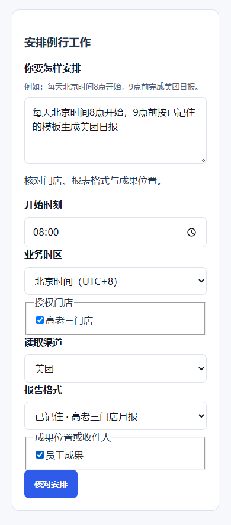

## A Owner先看结论 {span=2}
```callout info 兼容版本已部署，正常冻结完成，评测准入热修待上线
Employee1.0.2仍ACTIVE，139/139评测与用户批准记录保留。72版本Control、Web、PPT已正式部署并通过完整postflight，Browser保持。Metrics1.0.2、Office1.0.10和Skill0.2.1已走正常产品入口冻结；上层评测准入缺失已精确修复，Control-only热修镜像通过，传输中尚未部署。
成果文件仍0，客户验收仍0／2。
```

小碑的管理员确认与发布校验修复事实保留；真实回复与套餐上架仍需业务证据。

用户已接受限定Memory初次启用与抖音短时签名许可边界；具体实现、发布和真实验收分别验证。Routine生产延后，钉钉两项具体缺陷仍须修正。

[查看默认上岗路径与当前边界](./product-experience-review.html#panel-F)

## B 首单当前步骤与证据边界 {span=2}
**72完整postflight通过；三个新能力已正常冻结。上层评测准入缺失的Control-only修复镜像通过，传输中尚未部署。**

| 检查项 | 已验证事实 | 下一步 |
| --- | --- | --- |
| 正式运行版本 | Control、Web、PPT72正式发布PASS；Browser保持 | 热修仅更新Control，读回正式健康 |
| 能力准备 | Metrics1.0.2、Office1.0.10、Skill0.2.1正常201冻结 | 复用冻结草稿完成正常评测、本人审阅和发布 |
| 精确热修 | 镜像与私有Schema87/147/170通过；尚未部署 | 正式上线后重试正常评测入口 |
| 同一员工 | 1.0.2 ACTIVE；139/139与批准记录保留 | 1.0.4正常登记、评测、审核与升级 |
| 真实业务 | 既有12条Browser证据；月度Source/Artifact仍未验证 | 真实来源 → 原模板校验 → 下载 → 自然修改 |
| 客户验收 | 仍0／2 | 真实成果与客户确认 |

**下一次可见成果：** 完成热修并读回正式健康。复用冻结草稿，评测、本人审阅并发布三项能力。再登记与评测1.0.4，审核升级后核对真实月报、下载和修改。

**首单范围：** 原模板保留五张表、十二个公式，缺失来源保持未知。Memory110、定时、钉钉和抖音不成为首单前置。

## C 报表员工：下一次可验收什么 {span=2}

### 美团＋点评取数与原模板

兼容版本72已部署 → 三项能力正常冻结 → 评测准入热修待上线。

Employee1.0.2仍ACTIVE，139/139评测与用户批准记录保留。72版本Control、Web、PPT已正式部署并通过完整postflight，Browser保持。Metrics1.0.2、Office1.0.10和Skill0.2.1已走正常产品入口冻结；上层评测准入缺失已精确修复，Control-only热修镜像通过，传输中尚未部署。

**尚缺：** 评测上层曾返回明确的能力准入缺失；精确版本热修正在传输，尚未部署。三个能力仍未发布，1.0.4未启用，真实月份来源与原模板成果未完成。

**下一可见成果：** 完成热修并读回正式健康。复用冻结草稿，评测、本人审阅并发布三项能力。再登记与评测1.0.4，审核升级后核对真实月报、下载和修改。

*今日交接证据；仍受下列验收边界限制。*

### 你的模板与自然修改

原模板109升级保留现有月报与租户评测；精确包已独立复核。

Office109升级包保留既有月报职责和租户评测，fixed139实际通过并独立L2复核。用户已接受当前员工、已授权门店的限定格式记忆初次升级边界。

**尚缺：** 尚需具体初次启用路径实现、精确复核、正常发布与本人模板修改验收；生产未启用。

**下一可见成果：** 完成已获授权的限定初次启用路径与正负证据，再正常发布、本人确认和自然修改；不成为首单前置。

*今日交接证据；仍受下列验收边界限制。*

### 抖音与多渠道报表

短时签名许可边界已获接受；实际CLI已构建，扩展与完整来源证据待齐。

PR801 exact80abd9b2固定113与源码补丁对照通过。用户接受绑定本人、员工、门店、连接与浏览器目标的短时服务器签名许可；原生回执和执行锁继续防重放。Linux CLI实际构建14,465,704字节并完成版本、帮助与hash读回。

**尚缺：** 扩展仍在恢复介质流程中，完整受审源码→原生产物→镜像provenance未齐；live许可/key配置、真实平台取数与下载仍未验收。

**下一可见成果：** 完成扩展恢复和完整产物来源验证。复核许可实现后正常发布，再验真实期间报表与下载。

*今日交接证据；仍受下列验收边界限制。*

[查看当前发布评审稿](https://github.com/iddunk/AstraStaff/pull/801)

**首单不等待：** Office1.0.9、Memory110、定时、钉钉和抖音。

## D 运营员工：评论与套餐线 {span=2}

### 真实评论、常规自动回复与例外

管理员确认路径与发布校验修复已合入；运营员工候选尚未部署。

PR812补齐同租户管理员确认入口，PR813修复发布来源组合。当前15个runner目标校验通过；自动准入与最小门店摘要已有明确批准。

**尚缺：** 正常生产组合与运营员工启用仍待完成。0.5仅只读/预览；真实回复、套餐上架与客户验收未完成。

**下一可见成果：** 独立发布前核对当前生产，由管理员确认真实门店范围。启用后读取真实评论或套餐材料，并给出预览。

*今日交接证据；仍受下列验收边界限制。*

[查看当前发布评审稿](https://github.com/iddunk/AstraStaff/pull/813)

### 自动回复规则与暂停

管理员确认路径与发布校验修复已合入；运营员工候选尚未部署。

PR812补齐同租户管理员确认入口，PR813修复发布来源组合。当前15个runner目标校验通过；自动准入与最小门店摘要已有明确批准。

**尚缺：** 正常生产组合与运营员工启用仍待完成。0.5仅只读/预览；真实回复、套餐上架与客户验收未完成。

**下一可见成果：** 独立发布前核对当前生产，由管理员确认真实门店范围。启用后读取真实评论或套餐材料，并给出预览。

*今日交接证据；仍受下列验收边界限制。*

[查看当前发布评审稿](https://github.com/iddunk/AstraStaff/pull/813)

### 菜品 / 套餐上架

管理员确认路径与发布校验修复已合入；运营员工候选尚未部署。

PR812补齐同租户管理员确认入口，PR813修复发布来源组合。当前15个runner目标校验通过；自动准入与最小门店摘要已有明确批准。

**尚缺：** 正常生产组合与运营员工启用仍待完成。0.5仅只读/预览；真实回复、套餐上架与客户验收未完成。

**下一可见成果：** 独立发布前核对当前生产，由管理员确认真实门店范围。启用后读取真实评论或套餐材料，并给出预览。

*今日交接证据；仍受下列验收边界限制。*

[查看当前发布评审稿](https://github.com/iddunk/AstraStaff/pull/813)

### 例外审阅、选定批量与发布授权

执行与逐条读回。

执行桥正核对审批内容与平台实际动作。

**尚缺：** 真实提交与逐条平台回执仍未验收。

**下一可见成果：** 核对精确版本与授权，再逐条读取平台结果。

*13:50最后核验，本次未重验。*

普通回复沿已确认政策处理；高风险例外保留审阅。


## E 共享能力与员工体验 {span=2}

### 记住偏好、替换与忘记

限定格式记忆边界已获接受；初次启用实现与正常发布待完成。

对话记住、查询、替换、忘记的本地持久读写路径及Office109升级包已验证。用户接受当前本人、当前员工与已授权门店的限定NONE→EMPLOYEE路径；仅本人明确发起的保存、替换、忘记三项免逐次审批。

**尚缺：** 具体初次启用路径实现、精确版本复核和必要正负证据仍未闭合；生产与下一期复用未验收。

**下一可见成果：** 按已获接受的限定边界补齐实现与验证，再正常发布和本人确认；其他写入、高风险动作与审批规则保留。

*今日交接证据；仍受下列验收边界限制。*

### 定时日报、周报与评论轮询

运营一次准备升级入口与正常发布接线已修复，精确包独立复核通过。

PR821 038ae0ec / source02909eed完成正常发布接线修复并独立L2复核，new73实际通过。0169/0177精确源码获SOURCE_APPROVE；生产仍DEFER。

**尚缺：** 当前108只管理职责；自动到点产报仍需三项Office权限与窄报表Skill。正常迁移的fresh ledger/主键/入向外键核对、真实managed模型/用量与成果仍待验证。

**下一可见成果：** 保留源码批准与生产延后。完成发布、权限升级和迁移核验，再验真实到点成果与用量。

*今日交接证据；仍受下列验收边界限制。*

### 员工工作进度与成果下载

同一员工仍1.0.2 ACTIVE；1.0.4准备评测审核入口随72上线。

旧12条只读等待正常撤回历史保留。72版本提供固定1.0.4准备、评测与审核入口；三能力已正常冻结，评测准入热修待上线。

**尚缺：** 1.0.4尚未注册、评测、审核或启用；原模板成果、下载与自然修改尚未验收。

**下一可见成果：** 正常发布三项能力，评测审核并升级1.0.4。再核对同一对话的真实下载与一次修改。

*今日交接证据；仍受下列验收边界限制。*

### 驾驶舱与员工排查

员工用量。

线上可查看整体、租户和员工用量。

**尚缺：** 深度事件定位仍未上线。

**下一可见成果：** 沿同一时间范围继续定位具体失败调用。

*13:50最后核验，本次未重验。*

### 模型选择与正常性

正确客户与员工。

模型配置读回与变更审阅已有候选。

**尚缺：** 线上准入与实际切换仍未验证。

**下一可见成果：** 先读回当前配置，再核对真实调用是否生效。

*13:50最后核验，本次未重验。*

### 全产品样式规范

基础样式已上线，完整页面待验。

共享基础按钮与侧栏样式已上线。

**尚缺：** 完整员工布局与业务入口仍待上线验收。

**下一可见成果：** 从正常入口核对完整员工页的桌面与手机体验。

*13:50最后核验，本次未重验。*

### 钉钉扫码接入

本人扫码UX有证明；两项具体接入缺陷要求修正。

PR797 1ef011ea的本人扫码UX已验证；本轮精确复核指出TEMP/schema-shadowing防护与manual/auto0182准入证明兼容缺口。

**尚缺：** CHANGES_NEEDED：TEMP/schema-shadowing防护，以及0176人工decision/Run与0182自动准入的同canonical证明兼容，均未完成修复验证。

**下一可见成果：** 修复两项具体缺陷并验证正负读回。再接正式企业配置，验证本人扫码与同员工消息往返。

*今日交接证据；仍受下列验收边界限制。*

[查看当前发布评审稿](https://github.com/iddunk/AstraStaff/pull/797)

### 能力评测、人工审阅与发布

三能力已发布；Employee1.0.2真实评测、用户审核与启用完成。

沿已发布三能力完成Employee级139/139真实评测。用户明确批准精确封存后，正式审核和同一员工1.0.2启用已成功。

**尚缺：** 首单能力与员工发布已无阻塞；当前进入真实月报交付，不把发布通过计为客户完成。

**下一可见成果：** 直接交付真实原模板月报，保留真实来源、文件校验、下载修改与客户验收。

*今日交接证据；仍受下列验收边界限制。*

### 业务运营与系统运营的P0流程

管理员确认路径与发布校验修复已合入；运营员工候选尚未部署。

PR812补齐同租户管理员确认入口，PR813修复发布来源组合。当前15个runner目标校验通过；自动准入与最小门店摘要已有明确批准。

**尚缺：** 正常生产组合与运营员工启用仍待完成。0.5仅只读/预览；真实回复、套餐上架与客户验收未完成。

**下一可见成果：** 独立发布前核对当前生产，由管理员确认真实门店范围。启用后读取真实评论或套餐材料，并给出预览。

*今日交接证据；仍受下列验收边界限制。*

[查看当前发布评审稿](https://github.com/iddunk/AstraStaff/pull/813)




## F 保留的目标日期与风险 {span=2}
**排期与估算保留13:50基准；本次未重新预测或改期。**
| 里程碑 | 目标日期 | 当前状态 | 风险判断 |
| --- | --- | --- | --- |
| 美团＋点评真实来源 → 原模板部分月报 → 下载＋一次修改 | 10月11日20:00 | no 尚未交付；Employee1.0.2已启用，真实原模板月报请求已发送 | **高**；路径已收敛但剩余工时仍待共享产品经理重估 |
| 评论原文、回复草稿、套餐预览 | 10月13日 | warn 本地只读候选与恢复动作已就绪，生产启用／真实评论未验 | 中 |
| 抖音真实来源与独立报表 | 10月15日 | warn 本地候选完成，真实门店确认和正式导出未验 | 中高 |
| 自动回复／例外审批、模型用量诊断 | 10月20日 | warn 多项基础存在，真实行为与回执未闭合 | 中高 |
| 多渠道、模板修改与记忆、计划、钉钉 | 10月22日 | warn 本地与独立包有实质进展，跨能力生产E2E未验 | 中高 |
| 美团真实套餐上架 | 10月28日 | no 真实提交／读回未验 | 中高 |
| 抖音真实套餐上架 | 11月2日 | no 真实提交／读回未验 | 高 |
| 全范围联合验收 | 11月4日 | no 完整客户业务验收仍0／2 | 高；保守窗口11月6–20日 |

**估算规则：**第76版的“美团剩余9／18个专注小时”和结构化状态中的15／28小时均不再作为当前估算。没有共享产品经理重新核定的剩余包和依据时，看板只写“尚未核实”，不会按时间流逝自动扣减。

**排期规则：**上述目标日期保持用户确认的基准，本看板不自行改期。
12:00检查已过：生产复验和员工升级路径已经明确，但新剩余工时仍未核定。若正常发布／升级实际耗时使10月11日20:00不可守，共享产品经理应提交延期风险与是否重基线。

## G 怎样区分进展与客户完成 {span=2}
| 证据状态 | 可以判断什么 | 仍不能判断什么 |
| --- | --- | --- |
| 代码整合验证 | 当前授权、聊天读取与相应回归通过 | 正常生产已发布或客户首次保存通过 |
| 真实本地数据库、封存待审 | 运营准备和计划有真实持久化证据 | 员工已激活、真实评论已回复或套餐已上架 |
| 最终本地审阅候选 | 抖音与钉钉候选可审阅、可进入正常发布 | 正式平台取数、扫码收发或正常客户下载已通过 |
| 部分原模板证明 | 既有模板结构与部分字段得到核对 | 完整客户报表与下载修改已验收 |
| 客户业务验收 | 当前账号、员工、真实来源与可核对结果均通过 | 当前仍为0／2；不能用候选或测试数量代替 |

记忆与定时的69项、29项检查有重叠。运营准备的248项属于同一数据库证据，不在多个模块重复累计。

截图保留原有本地示例标记，不作为本次生产或客户验收证明。

## H Owner现在看什么与怎样反馈 {span=2}
**首单：** Employee1.0.2已审核启用，解析修复已上线。当前看月报兼容补丁正常评测和发布后的重试，再验目标月份来源、原模板成果、下载和自然修改。

**钉钉：** 正式回调、正常迁移与官方配置完成后，再安排真人扫码和当前员工收发验收。

**运营：** 正常发布后，先验真实评论草稿和套餐预览，再按经营规则与授权验证真实动作。

**GitHub Owner反馈：** 真实操作已验证：Owner 使用 GitHub 登录，在本页保存“首次成果引导：接受建议”；记录 #2 已自动归档，Codex 已读取并写回“团队已收到”。

这条产品方向已确认；不代表对应员工体验已上线，也不改变餐饮两条线的客户验收状态。

体验共创为第86版。全局产品状态为第103版。提交反馈不会把候选变成上线，也不会把未核验事实改为完成。

[产品控制塔：Control、架构与落地状态](./control-tower.html)

[生产真实体验共创：截图、用户故事与产品定调](./product-experience-review.html)

