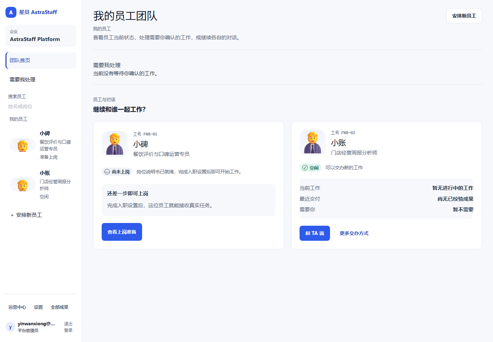
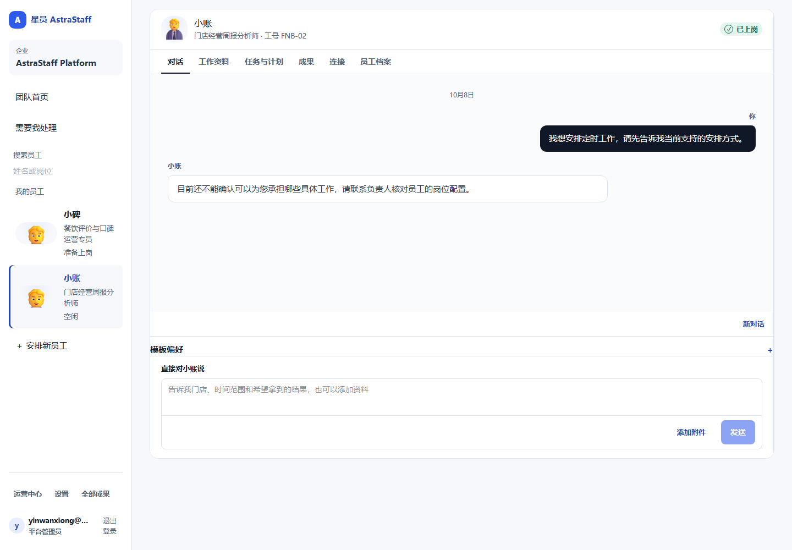
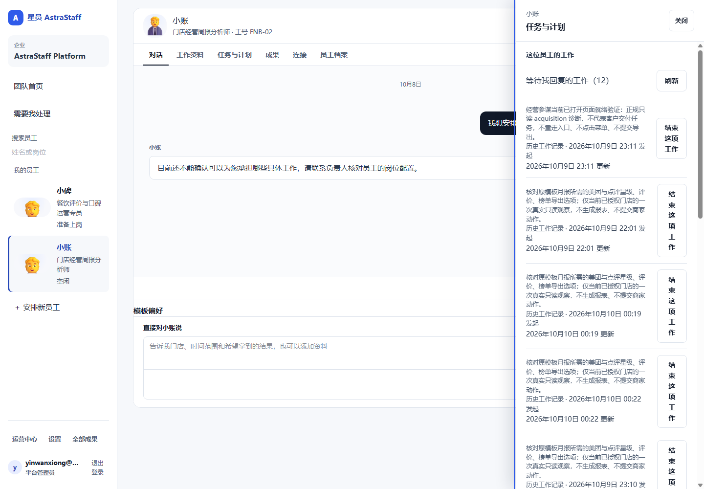

## A Owner 判断 {span=2}
```callout warn 方向正确，但还没到“好用、易用、爱用”
产品心智已经像“数字员工”：团队、员工、对话、连接和审批都在正确位置。当前主要问题是员工状态、对话能力、工作记录和成果之间没有形成一致的可信体验。完整客户业务验收仍是 0／2。
```

```kv cols=3
产品方向: ✓ Employee-first 已成立
报表员工: ! 已上岗，但能力回答和成果不可信
运营员工: ! 能力候选很多，生产仍未上岗
需要你: ✓ 审批中心保持干净
最大体验风险: 已上岗 ≠ 真的会干活
最大研发风险: 局部能力继续扩，首个 Outcome 仍未出现
```

## B 用户真正应该经历什么 {span=2}
```flow LR
(老板进入工作台) -> 团队首页: 看谁在工作
团队首页 -> *小账: 经营报表员工
*小账 -> 对话: “上个月经营怎么样？”
对话 -> 工作: 员工自己取数并显示安全进度
工作 -> 成果: 真实来源 + 原模板 + 可下载
成果 -> 对话: “这里改一下，以后都按这个格式”
对话 -> 长期职责: “每月10号10点发给我”
长期职责 -> (下次自动交付): 同一员工继续负责
```

目标体验只有一个：老板记住“找小账”，不用记住 Task、Run、Capability、模板版本或数据采集步骤。

## C 第一眼：团队页已经像员工产品 {span=2}


**做对了：** 员工有名字、岗位、状态；“需要我处理”没有制造静态提醒；团队到员工的入口清楚。

**还缺：** 小账虽然显示“空闲 / 可以交办”，却没有任何已校验成果。用户第一次进入时看不到“这个员工曾经把什么事情做好过”，信任还没有建立。

## D 用户故事：我想安排每周报告 {span=2}


**用户说：** “我想安排定时工作，请先告诉我当前支持的安排方式。”

**生产当前回答：** 员工表示还不能确认自己能承担哪些具体工作，并让用户联系负责人核对岗位配置。

```flow LR
已上岗/空闲 -> {员工能说明自己的职责吗？}
{员工能说明自己的职责吗？} -> no 暂不可用/待配置: 状态要诚实
{员工能说明自己的职责吗？} -> yes 给业务例子: 日报 / 周报 / 月报 / 临时分析
给业务例子 -> 用户自然交办
用户自然交办 -> 形成职责与排期
```

**我的判断：P0。** 一个“已上岗”的员工必须准确知道自己当前会什么、能访问什么、哪些工作可以定时。否则所有后续页面优化都救不了信任。

## E 用户故事：我只想看哪些事需要我 {span=2}


生产当前显示 **“等待我回复的工作（12）”**。其中包含经营参谋只读诊断、导出选项核对、已捕获来源确认等工程验证语句，还有英文内部请求。

| 用户看到的对象 | 应该出现 | 当前判断 |
| --- | --- | --- |
| 真正需要老板补资料或做决定 | 是 | ok |
| 待批准的高风险业务动作 | 是 | ok |
| 员工正在做的业务工作 | 在“正在做”中展示 | warn |
| 工程诊断 / provider probe | 只在运营诊断 | no |
| 历史测试 Work | 不占用“需要你” | no |

这不是文案问题，而是 **customer Work projection 的边界错误**。更严重的是，同一批 WAITING_FOR_USER 还让生产版本页进入 BUSY，直接阻塞员工升级。#791 已给出客户投影最小修复；Control 4.2 进一步规定内部工程 Work 不能长期占用客户生命周期，历史状态必须走证据化 safe-close。

## F 默认无人工审核：本地闭环已通过 {span=2}
```callout ok Owner已确认，当前按正常路径实现
默认去掉人工审核。小碑通过自动检查后，负责人只确认必要的门店读取范围，再直接开始工作。
特殊能力或依赖以后真的需要审批时，再增加具体例外。当前不预建通用审批卡点。
```

```flow LR
准备员工 -> 自动检查: 评测证据
自动检查 -> 确认范围: 当前门店与读取授权
确认范围 -> 开始工作
自动检查 --> 具体缺项: 失败 / 过期 / 权限不足
```

**当前本地结果：** 自动准入实际写入部署并读回 ACTIVE；人工决定记录为 0，派生 Employee evaluation run 为 0。身份、门店、Brain 和 provider 是本地合成边界，不是生产验收。

**页面结果：** 准备页不再出现独立审核、审核理由、批准或拒绝。负责人看到具体负责门店、读取评价与套餐资料的范围，再点击“确认范围并开始工作”。员工已启用后刷新会读回状态，不再退回草稿准备步骤。

**仍保留：** 当前企业权限、员工与能力证据、门店范围、失败与撤销后的准确阻止。明确的业务例外审批以后按具体能力增加，不影响当前happy path。

**剩余门禁：** 独立技术复审、目标分支薄组合、正式迁移、真实企业账号读回和真实评论／套餐业务结果。

## G 核心产品原语现在落到哪了 {span=2}
| 产品原语 | 生产用户当前感知 | 状态 | 下一次证明 |
| --- | --- | --- | --- |
| Employee | 团队和员工身份清楚 | ok 已有骨架 | 状态与真实能力一致 |
| Conversation | 主入口成立，但能力自述失败 | no P0 | 能回答职责并完成一次自然交办 |
| Responsibility | 定时本地链已有，生产用户看不到已确认职责 | warn | 聊天创建后页面与聊天都读同一安排 |
| Work | 有页面，但被工程诊断污染 | no P0 | 只显示业务工作和真实“需要你” |
| Outcome | 小账成果页为空 | no P0 | 任意月份真实报表正常下载并可继续修改 |
| Context / Memory | 门店资料可见，格式记忆独立包已有 | warn | 下一期自动复用 + 用户可改/忘记 |
| Connection | 美团、抖音已连接，语义清楚 | ok | 连接状态与真实取数持续一致 |
| Policy / Approval | 审批中心空状态清楚 | ok 部分 | 常规自动、例外才找人 |
| Channel | 钉钉入口可见但未接入 | warn | 真人扫码 + 同员工真实收发 |

**当前最关键的缺口不是再增加产品原语，而是把 Employee → Responsibility → Work → Outcome 串成第一条生产真链。**
**生产首单发布链已现场核实：**

| 生产门槛 | 真实读回 | 产品含义 |
| --- | --- | --- |
| CURRENT capability 候选 | operations-reporting 0.2.0、Office 1.0.8、metrics 1.0.1 均可正常读取 | publication-read 恢复已经生效，不要再开发读取链 |
| 三项能力当前状态 | 都是“材料待复核”；真实评测、CapabilityVersion、生产激活均为空 | 首单当前缺的是正常发布动作 |
| 小账版本 | 当前 1.0.1；没有已评测审核的升级目标 | 1.0.2 尚未进入可升级状态 |
| 1.0.2 登记 plan | `SETUP_REQUIRED` | 先完成三项 capability 发布和评测准备 |
| 1.0.2 评测 plan | 当前 503 | 前置 canonical candidate / registry / suite 尚未成立，不是另一个模型问题 |
| 升级就绪 | BUSY | 现有内部诊断 WAIT 同时在阻塞版本生命周期 |

**首单最短路线已经确定：** 先 safe-close 旧内部只读诊断，发布三项首单能力，再登记、评测、审核 Employee1.0.2 并升级小账。

随后只跑真实 Outcome：真实月份取数 → 原模板下载 → 同会话自然修改。Memory110、Office1.0.9、钉钉和抖音都不作为这一首单前置。


## H 我们共同定调 {span=2}
| 审查项 | 推荐方向 |
| --- | --- |
| 一级导航 | 用“工作”承载正在做、需要你、长期职责和已完成 |
| 首次成果引导 | 提供三个可交办例子，说明真实可用来源 |
| 资料与连接 | 资料放门店、口径、模板和记忆；连接负责账号和访问范围 |

首次使用 GitHub 登录，之后在本页直接保存意见。GitHub 保存历史，页面自动读取；草稿不代表团队已收到。

反馈可确认或调整方案。涉及 Control 的改变形成明确提案，等待 Owner / Architecture Authority 确认。

以后产品方向、UX、客户体验和各业务线进展都回到这一套 Pages；表达不够时扩展共享模型，不另建一套。
