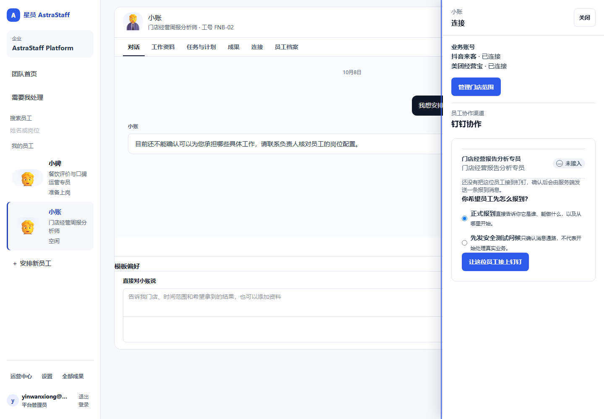
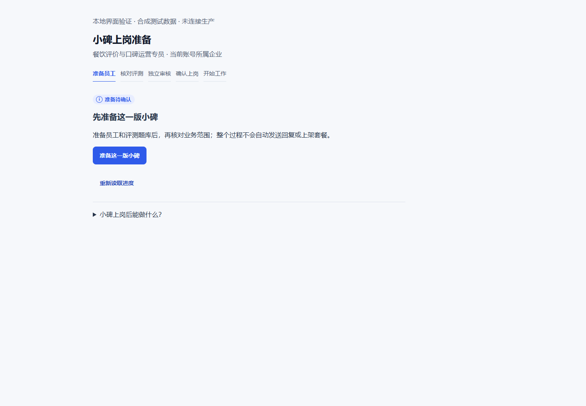

## A 一句话判断 {span=2}
```callout warn 产品方向已经像“数字员工”，但还没形成第一条让老板真正信任的成果闭环
团队、员工、对话、连接、工作这些位置基本对了。现在最重要的体验问题不是再加页面，而是：老板找小账说一句话后，能稳定看到它在做什么、拿到真实月报、继续改，并相信下次它还记得。
```

```kv cols=3
产品心智: ✅ 对
首个真实Outcome: 🔴 未验收
员工自述: ✅ 已修过
“需要你”噪音: ✅ 已清理过
默认上岗审核: ✅ 已按你意见移除
当前必须你决定: ✅ 无
```

**当前最大体验风险：** “已经上岗”看起来像会干活，但用户还没亲手拿到一份可复用的真实成果。

## B 用户最终只应该经历这条路径 {span=2}
```flow LR
老板打开团队 -> *小账: 经营报表员工
*小账 -> 对话: “上个月经营怎么样？”
对话 -> 进度: 正在取数 / 正在生成
进度 -> 成果: 原模板月报 + 真实来源 + 下载
成果 -> 对话: “这块改一下”
对话 -> 新成果: 第二版
新成果 -> 对话: “以后每月10号发我”
对话 -> 长期职责: 下个月自动继续
```

老板不应该知道 Capability、Run、Task、评测编号、镜像 SHA，也不应该为正常员工升级点批准。

## C 第一眼：团队页 {span=2}


**现在做对了：** 有员工名字、岗位和状态；从团队直接进员工，心智是“找人干活”。

**下一步要变得更可信：** 员工卡片除了“空闲/工作中”，最好直接显示最近一次真实成果，例如“10月经营月报 · 已交付”，让用户第一眼知道这个员工真的干成过什么。

**建议方向：** 保持员工为一级对象，不回退成任务列表首页。

## D 对话：一句话能不能交办 {span=2}


员工“能做什么”的自述已经做过生产修复，这是对的。现在下一道门槛更简单：

> 用户说“上个月经营怎么样？”之后，不要回答一堆系统说明，要直接开始工作，并用业务语言持续告诉用户：正在读取哪个门店、哪个月份、现在进行到哪一步。

**目前研发方向与这个体验一致：** 今天上午正在继续做自然月份解析、保存模板复用、成果下载和读取修复。

**还没验收：** 最新组合下完整跑通一次生产对话。

## E “需要你”只能真需要你 {span=2}


之前出现过 12 条工程等待占用“需要你”，这个方向已经纠正。以后这里应该只出现两类东西：

| 应该出现 | 不应该出现 |
| --- | --- |
| 老板真的要补资料/做选择 | provider probe / CI / 工程诊断 |
| 高风险业务动作需要批准 | 正常发布、评测、员工小版本切换 |

**这次 Pages 也按同一个原则改：** 当前没有必须 Owner 审批的事项，就明确显示“无需你操作”，而不是把内部版本证据包装成待办。

## F 连接与上岗：少一步是一大步 {span=2}


**连接应该回答三个问题：** 登录的是谁？员工能访问什么？当前是否真的可用？

不要把“资料”和“连接”混成一页：
- **资料 / 记忆：** 门店信息、经营口径、模板、长期偏好。
- **连接：** 美团/抖音/钉钉账号、授权范围、登录状态。



**你已经定调的方向继续有效：** 默认上岗去掉人工审核；自动检查通过、确认必要范围与授权后直接启用。只有未来真的遇到特殊高风险能力，再单独补例外审批。

**这条不用再次审。** 当前要验的是实现是否真的按这个 happy path 工作。

## G 报表员工：下一次我建议你只验这 5 件事 {span=2}
| 验收动作 | 你应该看到什么 | 当前 |
| --- | --- | --- |
| 1. 说一句“上个月经营怎么样” | 员工直接开始，不让你配任务 | 🟡 待最新生产验收 |
| 2. 看工作进度 | 业务语言、真实门店和月份，不暴露工具链噪音 | 🟡 待验 |
| 3. 下载月报 | 原模板可正常打开，来源与缺失项说清楚 | 🔴 首份最新闭环未验收 |
| 4. 说“这里改一下” | 同一对话产出第二版 | 🔴 待验 |
| 5. 说“以后都按这个格式” | 明确记住，并在下一期自动复用 | 🟡 Memory 正在推进 |


**首个成果引导你已经接受过：** 没有成果时，提供三个真实可交办例子，并说明当前可用数据来源。该决定继续有效，不重复向你确认。

## H 现在共同审什么 {span=2}
```callout ok 当前没有阻塞开发的必选题
下面是你可以随时在手机上审的产品方向。你不回复，研发仍按现有 Control 继续；你改方向，才进入 Control 变更。
```

### 1. 一级导航：建议统一叫“工作”
“正在做 / 需要你 / 长期职责 / 已完成”都放在这里。不要把 Task、Plan、Schedule 分散成用户必须理解的不同产品。

### 2. 员工卡片：建议优先展示“最近成果”
比“空闲”更有价值。比如：**最近成果：9月经营月报 · 10月10日交付**。

### 3. 成果页：建议把“来源可信度”做成用户可读信息
不是显示技术 evidence，而是“来自美团经营数据，覆盖 2026-09-01～09-30；点评某字段本期缺失，因此保持未知”。

### 4. 资料与连接：继续严格分开
资料回答“员工知道什么”；连接回答“员工能访问什么”。

**已确认、不再重复问你的两件事：**
- 首次没有成果时，给 3 个真实可交办例子。
- 默认上岗取消人工审核，特殊高风险能力以后再补例外。

每个模块下面仍保留“接受 / 调整 / 评论”。你手机上保存后，继续走现有 GitHub 反馈通道；团队应消费这些反馈并在页面回写处理状态。

[看产品落地总进度](./) · [看 Control 是否走偏](./control-tower.html)
